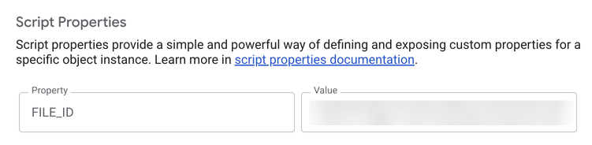
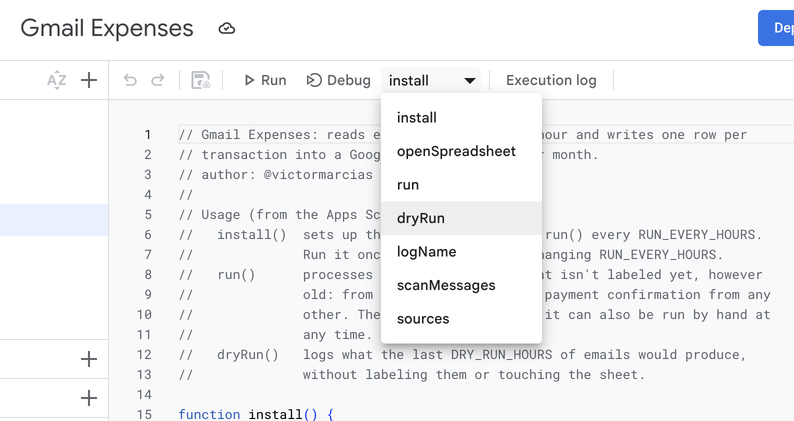
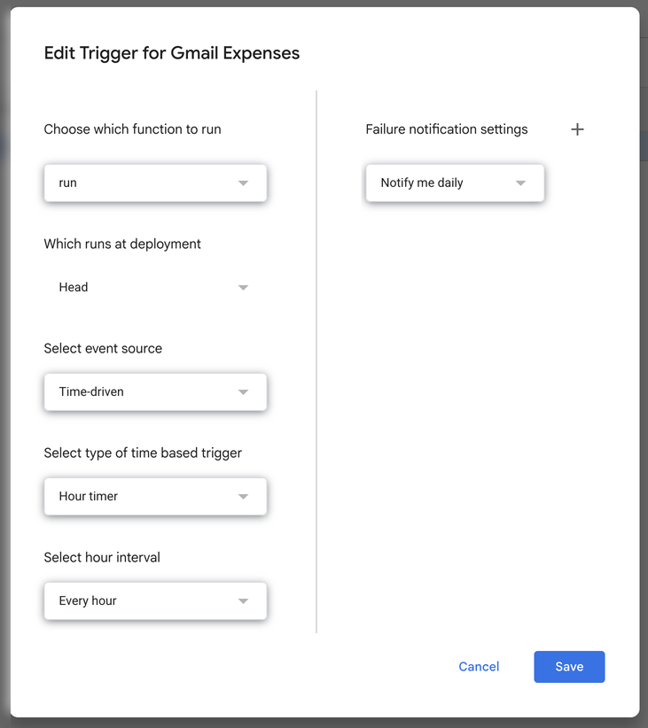

<p align="center">
  
</p>

# Gmail Expenses

[English](README.md)

📧 Google Apps Script que lee los mails de gastos de Gmail cada hora y los
escribe en una Google Sheet, una fila por transacción. Hecho para Argentina:
montos como `$ 12.345,67`, dólar cripto / blue, remitentes locales.

Solo lee el cuerpo del mail, nunca los PDF adjuntos.

## Qué detecta

| Columna | Remitentes | Estado |
|---|---|---|
| 🏠 Hogar | Pagos a `BILLS` (luz, gas, agua, impuestos municipales, teléfono, internet y TV). Se leen sus facturas (y las del seguro del hogar y los vencimientos de facturas del banco) | Pagar para facturas, Pagado para pagos |
| 🔁 Suscripciones | `SUBSCRIPTIONS`: servicios digitales (streaming, música, juegos, apps, cloud, IA). Sus recibos, en ARS o USD, sin los cargos de tarjeta de crédito | Pagado |
| 🩺 Salud | `PREPAGAS` (cobertura de salud), pagadas por débito automático | Pagado |
| 💳 Tarjetas | `CREDIT_CARDS` (solo resúmenes de tarjeta de crédito, no de cuenta: una fila por saldo, ARS y USD) | Pagar |
| 🚕 Transporte | Uber, Cabify | Pagado |
| 🛒 Compras | MercadoLibre, solo compras con débito / dinero en cuenta; pagos y transferencias a cualquiera que no se conozca (ver abajo) | Pagado |
| 🧾 Otros | Confirmaciones de pago de cualquier otro remitente (gateways, tiendas: "Tu pago ha sido acreditado a X", "Pago aprobado"), nunca de uno conocido | Pagado |
| 🥦 Supermercado | PedidosYa Market, Jumbo, Disco, Vea, Coto, Carrefour, Día, ChangoMâs, La Anónima | Pagado |
| 🛵 Delivery | PedidosYa (pedidos y Plus, no Market), Rappi (pedidos y Prime), Uber Eats | Pagado |

## La planilla

Una pestaña por mes (`2026-11`). Con las categorías por defecto, las columnas
son `Fecha`, `Detalle`, `Hogar`, `Suscripciones`, `Salud`, `Tarjetas`,
`Transporte`, `Compras`, `Supermercado`, `Delivery`, `Ocio`, `Mascotas`,
`Impuestos`, `Educación`, `Vacaciones`, `Otros`, `USD`, `Vencimiento` y
`Estado`.

- Cada corrida escribe en la pestaña del mes **en que corre**, no en la del
  mail: una factura enviada el 31 cae en la pestaña del mes siguiente, cuando
  se paga.
- Una fila por transacción, ordenada por fecha del mail (`Fecha`), con el
  nombre del remitente en `Detalle` (`Uber`) y el monto en su columna de
  categoría.
- Un mail del mismo hilo que llega dentro de `ADJUSTED_RECEIPT_HOURS` de uno
  anterior (un recibo ajustado) no agrega fila: queda el primer monto.
- `USD`: el monto original de los cargos en USD. La misma fila tiene también el
  monto en pesos en su categoría, al dólar que fija `USD_RATE` (cripto por
  defecto) de [DolarApi](https://dolarapi.com).
  La cotización usada está en la nota de la celda; si DolarApi está caída,
  se usa la última que funcionó y la nota lo aclara.
  La conversión es una referencia a la cotización del día de la corrida, no
  el monto realmente pagado: el monto real en pesos se copia a mano al
  conocerlo.
- Un mail con un monto en pesos y otro en USD (un resumen con ambos saldos, de
  algunos bancos) da dos filas: una con el saldo en pesos y otra con el saldo
  en USD y su conversión.
- `Vencimiento`: fecha de vencimiento de facturas y resúmenes.
- `Estado`: desplegable Pagar / Pagado. Los resúmenes de tarjeta y los avisos
  de vencimiento entran como Pagar; pasalos a mano a Pagado cuando los pagues.
- Pagos: las facturas de la casa y de teléfono/internet entran como Pagar.
  Muchos servicios no mandan confirmación de pago, así que marcalos Pagado a
  mano. Cada confirmación de pago o transferencia de un remitente de `PAYMENTS`
  ("Pago aprobado en X", "Transferiste a X") es una fila Pagado con el nombre
  del destinatario, en la categoría de un remitente conocido con el nombre del
  destinatario (`Hogar` para un servicio público), o `Compras` si no hay
  ninguno. Un mail que lista facturas por vencer da una fila Pagar por factura,
  con nombre y categoría de la misma forma (`Hogar` si no se conoce). Las
  confirmaciones de cualquier remitente que no se conoce (un gateway de pago,
  una tienda) se detectan por el asunto y van a `Otros`, salvo que se conozca
  al destinatario; se nombran con el destinatario del asunto, o con el
  remitente. Si se pagó con tarjeta de crédito, no agrega nada: ya está en el
  resumen.
- Fila `TOTAL` al final: sumas de cada categoría y de `USD`. Se rearma en cada
  corrida, así que las filas agregadas a mano se incluyen.

## Mails

- Cada mail procesado queda con el label `Gmail Expenses`, marcado como leído y
  en la bandeja de entrada. Borralos una vez que estén en la planilla.
- Si no se pudo leer el monto, igual se le pone el label, sin fila: el motivo
  solo está en el log de la corrida (*Executions* en el editor de Apps
  Script). Después de arreglar los patrones, sacá el label y la próxima
  corrida lo vuelve a levantar.
- Cada corrida mira todos los mails sin label de la bandeja de entrada de un
  remitente conocido, y las confirmaciones de pago de cualquier otro remitente,
  sin importar cuán viejos sean. Los mails con label se saltean, así que nunca
  se agrega una fila dos veces. Los mails archivados nunca se miran.
- Una corrida deja de escanear a los 4 minutos (Apps Script la mata a los 6),
  escribe lo que tiene y le pone label solo a esos mails; el resto espera a la
  próxima corrida. La primera corrida sobre una bandeja llena puede necesitar
  algunos `run()` manuales.

## ⚠️ Doble conteo

Los resúmenes de tarjeta se suman al total. Todo lo pagado con tarjeta de
crédito que además tiene su propio mail (un Uber, una factura, la prepaga) se
cuenta dos veces: una en su columna y otra dentro del resumen. Las compras en
tiendas online, el streaming y los pagos ya saltean los cargos de tarjeta de
crédito por esta razón (`CREDIT_CARD`, cuando el mail lo dice); el resto no,
porque se asume que se pagan con débito o dinero en cuenta.

## Agregar un gasto a mano

[WebAppPage.html](source/WebAppPage.html) es una página de una pantalla:
elegís la categoría, escribís el precio y tocás Agregar. Escribe una fila
`Pagado` en la pestaña del mes actual, con el campo Detalle como detalle
(`Detalle` si no se edita). Los montos de más de 1.000.000 se rechazan, para
atajar un cero de más tipeado por error. Mientras la corrida automática
escanea, la página muestra "Corrida automática en curso…" y agrega la fila
cuando termina.

La sirve el propio script como web app que solo su dueño puede abrir, así que
el inicio de sesión de Google es la única autenticación. Para abrirla en el
celular:

1. Corré `./deploy-webapp.sh`. Sube el código, crea la web app y copia su URL
   (termina en `/exec`).
2. Mandá la URL al celular (AirDrop, una nota, un mensaje a vos mismo).
3. Abrila en Safari o Chrome e iniciá sesión en Google una sola vez.
4. *Compartir → Agregar a pantalla de inicio*: se abre como una app, ya con
   la sesión iniciada.

Después de un cambio en la página, corré `./deploy-webapp.sh` de nuevo:
publica una versión nueva y la URL no cambia.

## Instalación

Necesita [Node.js](https://nodejs.org). Desde el repo, corré:

```bash
./setup.sh
```

Instala [clasp](https://github.com/google/clasp) (la CLI de Google para Apps
Script), crea el proyecto de Apps Script y sube el código, y después abre cada
página donde hay que hacer algo a mano:

1. Activar la Apps Script API.
2. Crear la planilla y pegar su URL.
3. Agregar `FILE_ID` en *Project Settings → Script Properties* (el script
   copia el valor).

   

4. Correr `install()` desde el editor y aceptar los permisos. Crea el trigger
   que llama a `run()` cada `RUN_EVERY_HOURS`.

   

   

Se puede correr de nuevo en cualquier momento: saltea lo que ya está hecho.

Después, cada cambio sube con `./deploy-script.sh` (inicia sesión de su propio
usuario de `clasp` como `CLASP_ACCOUNT` de `.env` si hace falta, corre
`clasp push` y abre el proyecto). Antes copiá `.env.example` a `.env`. Para
procesar de inmediato, corré `run()` desde el editor.

> ⚠️ Editá en local, no en el editor web: `clasp push` pisa lo que se haya
> cambiado ahí.

## Configuración

Cada ajuste está explicado en un comentario al lado, en el archivo donde vive:

- [Config.gs](source/Config.gs): intervalo de corrida, opciones de `dryRun()`,
  la cotización del dólar y el label.
- [Categories.gs](source/Categories.gs): remitentes, categorías y sus patrones.
  Para agregar una categoría, agregá una clave a `CATEGORIES`.

Solo los IDs van en Script Properties.

### Probar cambios

Después de un cambio, corré `./deploy-script.sh` y después `dryRun()` desde
el editor: loguea lo que haría `run()` con los mails sin label de la bandeja
de entrada, más los que tienen label de las últimas `DRY_RUN_HOURS`, sin
poner labels ni tocar la planilla.

```
OK       [Salud] 12/11/2026 Prepaga – Tu factura está disponible
         $ 185000 | vence 22/11/2026 | Pagado
REVIEW   [Compras] 05/11/2026 Wallet – Pago aprobado en Empresa
         no amount found
         body: "Hola,\nLe pagaste a Empresa…"
SKIP     [Compras] 08/11/2026 Tienda – Compraste Auriculares
         skipIf matched
IGNORED  Delivery – 50% OFF en tu próximo pedido
         subject didn't match
```

Escribí los patrones propios contra el `body` que loguea para los mails
`REVIEW`: es el texto plano limpio contra el que corren los patrones, que a
menudo difiere de cómo se ve el mail.
