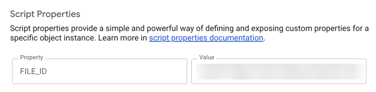
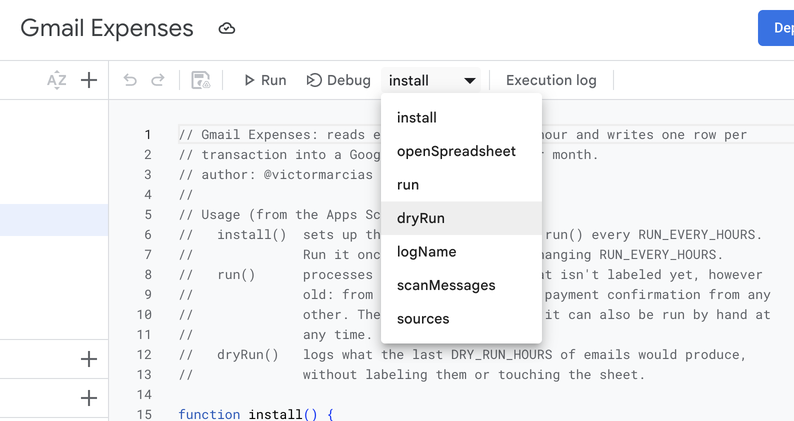
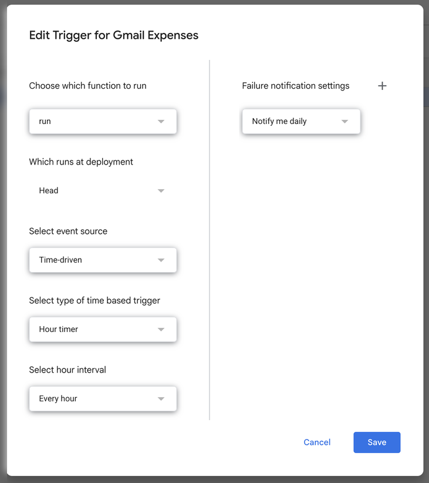

# Gmail Expenses

📧 Google Apps Script that reads expense emails from Gmail every hour and
writes them into a Google Sheet, one row per transaction. Made for Argentina:
amounts like `$ 12.345,67`, dólar cripto / blue, local senders.

It only reads the email body, never PDF attachments.

## What it detects

| Column | Senders | Estado |
|---|---|---|
| 🏠 Hogar | Payments to `HOGAR` (electricity, gas, water, municipal taxes) and transfers to `TRANSFERS` aliases (expensas, cleaning). Their bills are ignored. Due notices from a few senders (home insurance, a bank's invoices due) are read | Pagado, or Pagar for the due notices |
| 📱 Servicios | Payments to `SERVICES` phone, internet and TV (bills ignored). Digital services (streaming, music, games, apps, cloud, AI): their receipts, ARS or USD, credit card charges skipped | Pagado |
| 🩺 Salud | `PREPAGAS` (health insurance), paid by automatic debit | Pagado |
| 💳 Tarjetas | `CREDIT_CARDS` (credit card statements only, not account statements: one row per balance, ARS and USD) | Pagar |
| 🚕 Transporte | Uber, Cabify | Pagado |
| 🛒 Compras | MercadoLibre, only debit / account money purchases; payments and transfers to anyone not known (see below) | Pagado |
| 🧾 Otros | Payment confirmations from any other sender (gateways, shops: "Tu pago ha sido acreditado a X", "Pago aprobado"), never from a known one | Pagado |
| 🛵 Delivery | PedidosYa (orders and Plus), Rappi (orders and Prime), Uber Eats | Pagado |

## The sheet

One tab per month (`2026-11`). With the default categories, the columns are
`Fecha`, `Detalle`, `Hogar`, `Servicios`, `Salud`, `Tarjetas`, `Transporte`,
`Compras`, `Delivery`, `Otros`, `USD`, `Vencimiento` and `Estado`.

- Each run writes to the tab of the month **it runs in**, not the email's: a
  bill sent on the 31st lands in next month's tab, when it's paid.
- One row per transaction, sorted by email date (`Fecha`), with the sender's
  name in `Detalle` (`Uber`) and the amount in its category column.
- An email of the same thread that arrives within `ADJUSTED_RECEIPT_HOURS` of an
  earlier one (an adjusted receipt) adds no row: the first amount stays.
- `USD`: the original amount of USD charges. The same row also has the amount
  in pesos in its category, at the dollar set in `USD_RATE` (cripto by
  default) from [DolarApi](https://dolarapi.com).
  The rate used is in the cell's note; if DolarApi is down, the last rate that
  worked is used and the note says so.
- An email with both a pesos and a USD amount (a statement with both balances,
  from some banks) gives two rows: one with the pesos balance, and one with the
  USD balance and its conversion.
- `Vencimiento`: due date for bills and statements.
- `Estado`: Pagar / Pagado dropdown. Card statements and due notices come in
  as Pagar; switch them by hand once paid.
- Payments: house and phone/internet bills are paid through a wallet, so their
  bills are ignored and only what was actually paid is added. Each payment or
  transfer confirmation from a `PAYMENTS` sender ("Pago aprobado en X",
  "Transferiste a X") is a Pagado row named after the payee, in the category of
  the recipient's alias if it's in `TRANSFERS`, or of a known sender with the
  payee's name (`Hogar` for a utility), or `Compras` if none. An email listing
  invoices due gives one Pagar row per invoice, named and categorized the same
  way (`Hogar` if unknown). Confirmations from any sender that isn't known (a
  payment gateway, a shop) are picked up by their subject and go to `Otros`
  unless the payee is known; they're named after the payee in the subject, or
  the sender. Paid by credit card, it adds nothing: it's already in the
  statement.
- `TOTAL` row at the bottom: sums for every category and `USD`. It's rebuilt
  on every run, so rows added by hand are included.

## Emails

- Every handled email is labeled `Gmail Expenses` and left in the inbox.
  Delete them once they're in the sheet.
- If the amount couldn't be read, it's labeled all the same, with no row: the
  reason is only in the run's log (*Executions* in the Apps Script editor).
  After fixing the patterns, remove the label and the next run picks it up
  again.
- Each run looks at every unlabeled inbox email from a known sender, and at
  payment confirmations from any other sender, however old. Labeled emails
  are skipped, so a row is never added twice. Archived emails are never
  looked at.
- A run stops scanning after 4 minutes (Apps Script kills it at 6), writes
  what it has and labels only those emails; the rest wait for the next run.
  The first run on a full inbox may need a few manual `run()`s.

## ⚠️ Double counting

Card statements are added to the total. Anything paid with a credit card that
also has its own email (an Uber, a bill, the prepaga) is counted twice: once in
its column and once inside the statement. Online shop purchases, streaming and
payments already skip credit card charges for this reason (`CREDIT_CARD`, when
the email says so); the rest don't, since they're assumed to be paid with debit
or account money.

## Setup

Needs [Node.js](https://nodejs.org). From the repo, run:

```bash
./setup.sh
```

It installs [clasp](https://github.com/google/clasp) (Google's CLI for Apps
Script), creates the Apps Script project and uploads the code, then opens each
page where something has to be done by hand:

1. Turn on the Apps Script API.
2. Create the sheet and paste its URL.
3. Add `FILE_ID` in *Project Settings → Script Properties* (the script copies
   the value).

   

4. Run `install()` from the editor and accept the permissions. It creates
   the trigger that calls `run()` every `RUN_EVERY_HOURS`.

   

   

It can be run again at any time: it skips what's already done.

After that, every change goes up with `./upload.sh` (`clasp push`, then it
opens the project). To process right away, run `run()` from the editor.

> ⚠️ Edit locally, not in the web editor: `clasp push` overwrites whatever
> was changed there.

## Configuration

Every setting is explained in a comment beside it, in the file it lives in:

- [Config.gs](Config.gs): run interval, `dryRun()` options, the dollar rate
  and the label.
- [Categories.gs](Categories.gs): senders, categories and their patterns.
  To add a category, add a key to `CATEGORIES`.
- `Transfers.gs`: the aliases you transfer to and their category (template:
  [Transfers.example.gs](Transfers.example.gs)).

Only IDs go in Script Properties.

### Testing changes

After a change, run `./upload.sh`, then run `dryRun()` from the editor: it
logs what `run()` would do with the unlabeled inbox emails, plus the labeled
ones from the last `DRY_RUN_HOURS`, without labeling anything or touching the
sheet.

```
OK       [Salud] 12/11/2026 Prepaga – Tu factura está disponible
         $ 185000 | vence 22/11/2026 | Pagado
REVIEW   [Compras] 05/11/2026 Wallet – Pago aprobado en Empresa
         no amount found
         body: "Hola,\nLe pagaste a Empresa…"
SKIP     [Compras] 08/11/2026 Tienda – Compraste Auriculares
         skipIf matched
IGNORED  Delivery – 50% OFF en tu próximo pedido
         subject didn't match
```

Write custom patterns against the `body` it logs for `REVIEW` emails: it's
the cleaned plain text the patterns run against, which often differs from
how the email looks.
